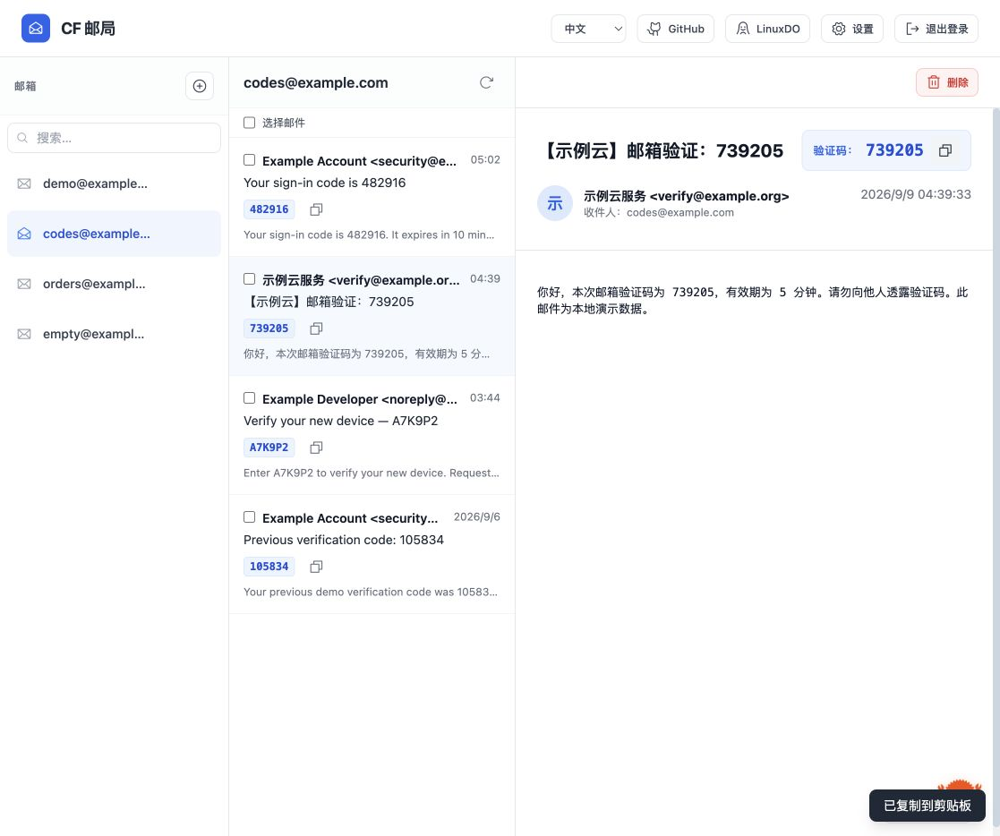
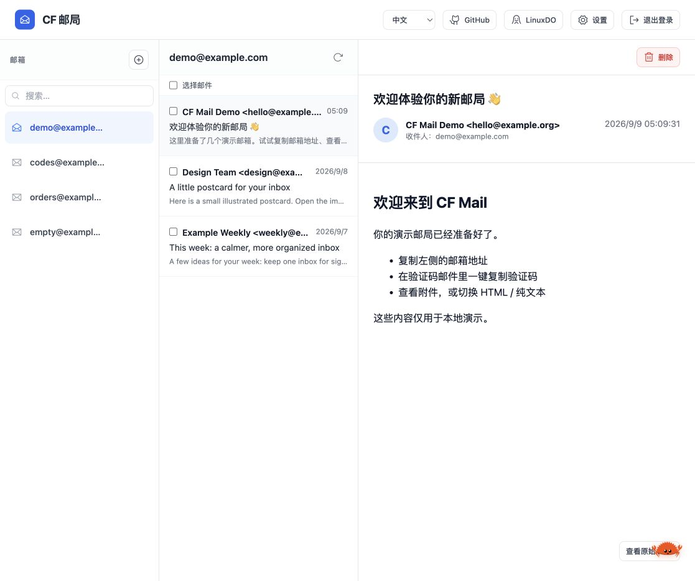
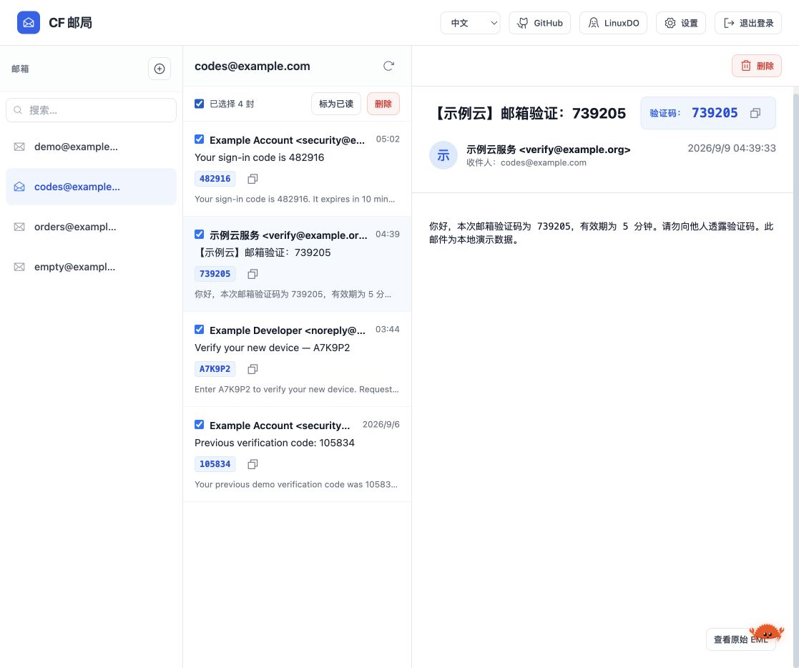
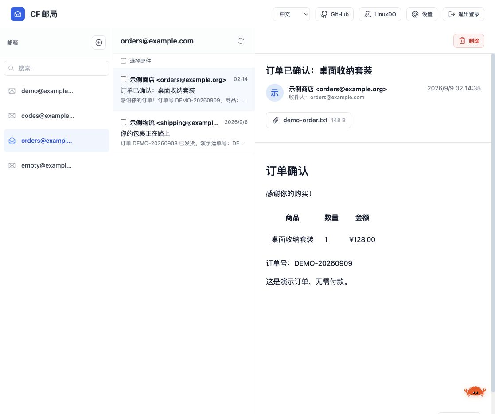
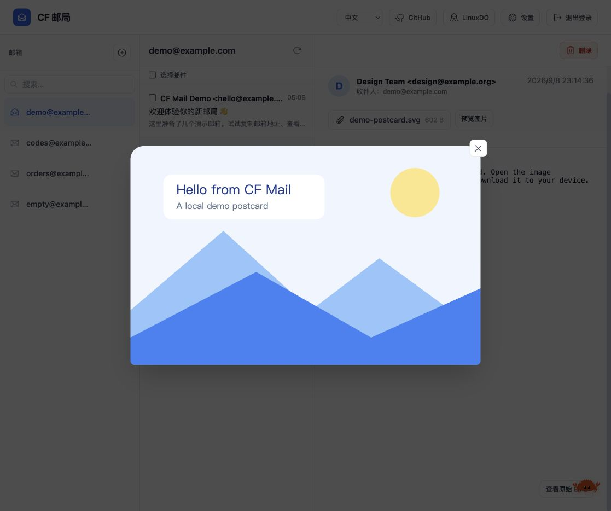
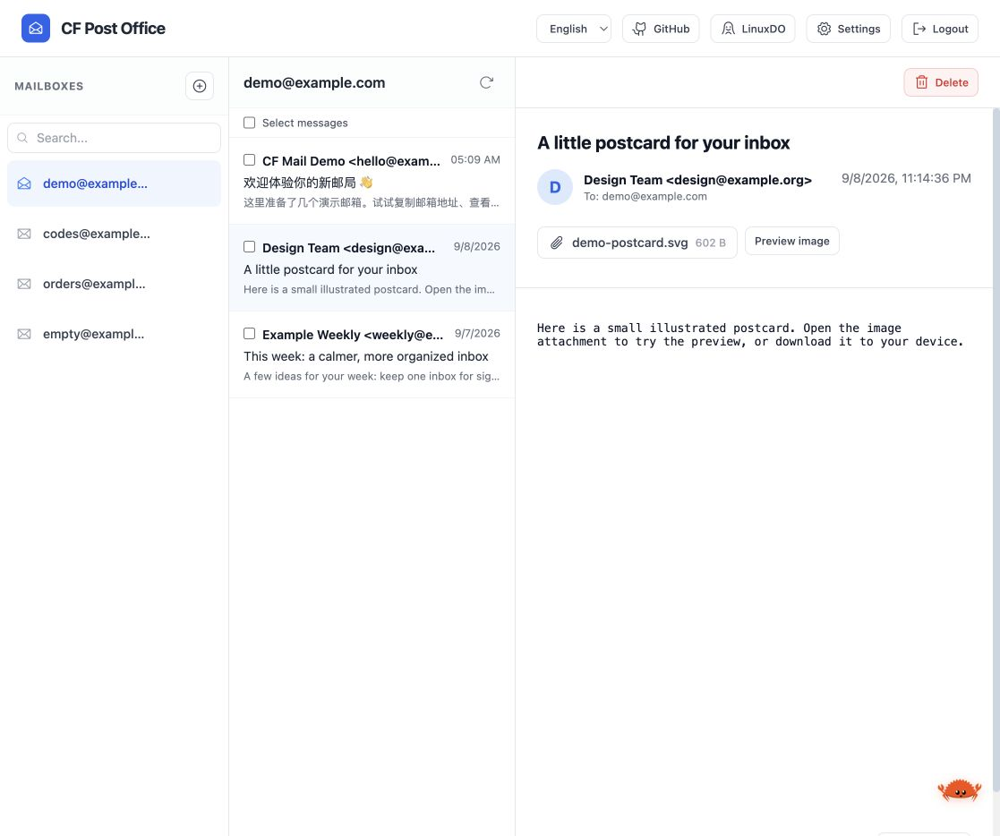

# CF-Mail

[](https://deploy.workers.cloudflare.com/?url=https://github.com/lino0n/cf-mail)

[部署使用](#部署使用) · [邮箱与通知设置](#邮箱与通知设置)

## 功能与界面

- 多邮箱管理：创建、搜索和删除邮箱，一键复制邮箱地址。
- 验证码提取：在邮件列表和详情中显示验证码，支持快速复制。
- 邮件阅读：查看 HTML 或纯文本邮件、下载原始 EML、下载附件和预览图片附件。
- 批量操作：批量标记已读、批量删除邮件。
- 自动创建邮箱：符合规则的新地址首次收到邮件时，自动创建邮箱并收信。
- Telegram 通知：推送新邮件和验证码，提供可直达邮件详情的链接。
- 中英双语：跟随浏览器语言，也可手动切换并保存偏好；支持手机端浏览。



<details>
<summary>查看更多界面截图</summary>

邮箱总览



批量操作



HTML 邮件与附件



图片附件预览



英文界面



</details>

截图使用本地演示数据。

## 部署使用

准备一个 Cloudflare 账号，以及使用 Cloudflare DNS、可以启用 Email Routing 的域名。项目需要一个 Worker、一个 D1 数据库和一个 R2 存储桶。

### 1. 部署 Worker

点击上方部署按钮，按引导连接 GitHub 并完成部署。Cloudflare 的部署流程支持自动创建 D1、R2 等资源；部署时确认所需资源均已创建并绑定。参见 [Deploy to Cloudflare 官方说明](https://developers.cloudflare.com/workers/platform/deploy-buttons/)。

也可以先 Fork 本仓库，再在 Cloudflare 的 Workers 项目创建流程中导入你的仓库。构建设置使用：

- 生产分支：`main`，或你实际使用的分支。
- Build command：留空。
- Deploy command：`npm run deploy`。

`npm run deploy` 会先构建 Vue 前端，再部署 Worker。前端产物由 `wrangler.toml` 中的 `assets.directory = "dist/client"` 托管，无需填写 Pages 的 Build output directory。已有项目若仍使用 `npx wrangler deploy`，请将部署命令改为 `npm run deploy`，以包含前端构建。

### 2. 确认存储绑定

在 Worker 的 Bindings 中确认以下资源存在：

- `DB`：D1 数据库，保存邮箱、邮件内容、附件元数据及设置。
- `R2`：R2 存储桶，保存原始 EML 和附件文件。

如果部署流程没有自动配置，创建资源并补齐绑定。资源名称可以自定义，绑定变量名必须是 `DB` 和 `R2`；仓库中的 `wrangler.toml` 也应与实际资源配置一致。数据库表会在首次访问时自动初始化。

### 3. 登录管理页面

打开 Worker 的 `workers.dev` 地址或绑定的自定义域名，使用管理员密码登录，无需填写账号。

默认初始密码为：

```text
Changeyourpasswordbeforeusingcfmail
```

若仍使用该默认密码，首次登录会要求先设置新密码。也可以在部署前通过 `ADMIN_PASSWORD` 设置自己的初始密码。在页面完成改密后，系统使用 D1 中保存的密码哈希，后续修改 `ADMIN_PASSWORD` 不会覆盖已经设置的密码。

### 4. 接入域名并开始收信

在 Cloudflare 中为收件域名启用 Email Routing，按引导配置所需 DNS 记录，再将 **Catch-all → Send to Worker** 指向刚部署的 Worker。具体入口可参考 [Cloudflare 邮件路由文档](https://developers.cloudflare.com/email-service/get-started/route-emails/)。

回到邮局，创建第一个完整邮箱地址，例如 `hello@你的域名`。创建后，域名会出现在下拉框中，便于继续创建同域名邮箱。这里应填写已配置 Email Routing 的域名；仅在页面创建邮箱不会自动配置域名的邮件路由。

向该地址发送一封测试邮件，确认能够在邮局中查看。自动创建邮箱默认关闭，未提前创建的地址会拒收邮件；如需自动收取新地址的邮件，请按下一节开启。

## 邮箱与通知设置

### 自动创建邮箱

在设置中开启后，发往新地址的邮件会触发邮箱创建。地址中 `@` 前的部分必须满足设置里的最短长度、最长长度和首字符规则，否则来信会被拒收。

关闭后，需要先手动创建邮箱再收信。已有邮箱在两种模式下都可以继续收信。设置页还提供批量删除自动创建邮箱的操作。

### Telegram 通知

1. 在 Telegram 中联系 [@BotFather](https://t.me/BotFather)，通过 `/newbot` 创建机器人并取得 Bot Token。
2. 先给机器人发一条消息，再打开邮局设置，启用 Telegram 通知并填写 Token。
3. 点击“获取”读取 Chat ID，或手动填写目标聊天的 Chat ID。发送到群组话题时，可填写对应的 Topic ID。
4. 保存设置，再发送一封测试邮件确认通知能够送达。

已保存的 Token 不会回显。留空保存会保留原 Token；输入新值可替换，关闭通知并保存会清除 Token 和聊天配置。“获取”按钮需要当前输入框中有 Token。

成功登录或恢复有效会话后，系统会记录当前访问的 HTTPS 地址，用于生成 Telegram 通知里的邮件详情链接。打开链接仍需通过邮局登录；登录后会自动显示对应邮件。

## 更新已有部署

在 Fork 仓库中同步上游更新。连接 Workers Builds 的生产分支更新后，会按项目配置自动构建部署。

更新时继续使用原 Worker、D1 和 R2，并确认部署命令为 `npm run deploy`。当前初始化逻辑会补齐缺失的表、字段和默认设置，保留已有数据与配置；不要为普通升级重新创建存储资源。

## 安全与数据

管理页面和邮件接口使用登录保护。邮件 HTML 会经过清洗并在受限 iframe 中渲染，远程图片默认阻止加载；设置接口不返回密码哈希、会话签名密钥或已保存的 Telegram Token。

删除邮件或邮箱会同时清理关联数据，当前没有回收站。请在删除前确认需要保留的内容已经下载或备份。

## 鸣谢与许可

- [cloud-mail](https://github.com/maillab/cloud-mail)：Telegram 转发参考。
- [freemail](https://github.com/idinging/freemail)：验证码提取与部署逻辑参考。
- [LinuxDO](https://linux.do/)：中文技术社区。

本项目采用 [MIT License](LICENSE)。
